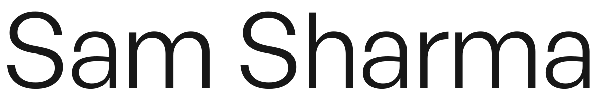

<picture>
  <source media="(prefers-color-scheme: dark)" srcset="assets/header-dark.svg">
  <source media="(prefers-color-scheme: light)" srcset="assets/header-light.svg">
  
</picture>

### Engineer & Founder

Co-Founder & CTO, building in stealth.

 

### Orrery Interactive

Founder & Game Developer · 2019–2023

Led a four-person game studio. Built motion-matching animation, shaders for grass, water and cloth, and production pipelines connecting Character Creator 4, Blender and Unreal with Unity.

### Solvynth

Founder · 2023–2026

Led product direction and hands-on engineering for applications, data workflows and automation. Paused in August 2026.

### ACES Team

Founding Software Engineer · 2025–2026

Built software, internal tools and business workflow automation alongside the people running the business.

 

[samxwayout.com](https://samxwayout.com) &nbsp; / &nbsp; [LinkedIn](https://www.linkedin.com/in/sam-sharma-bisht/)
